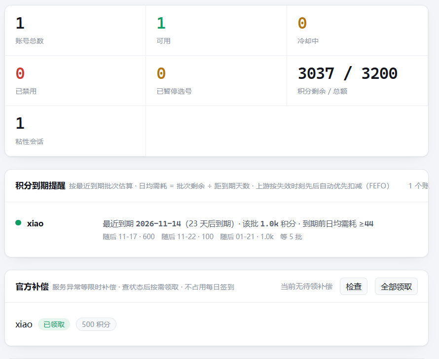
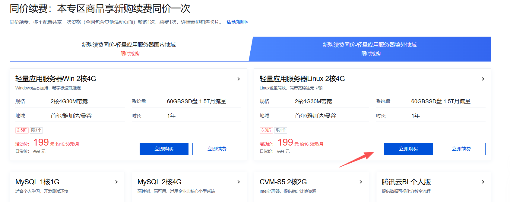
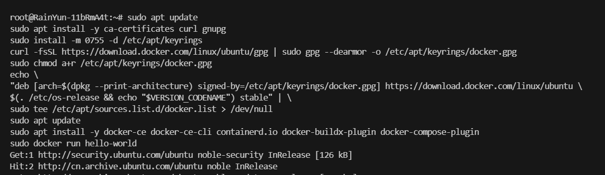
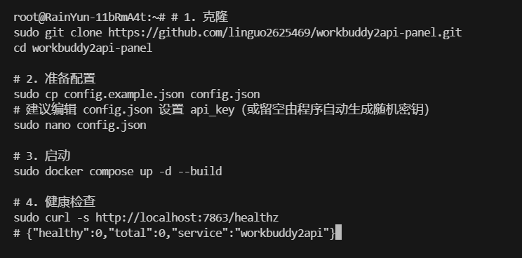
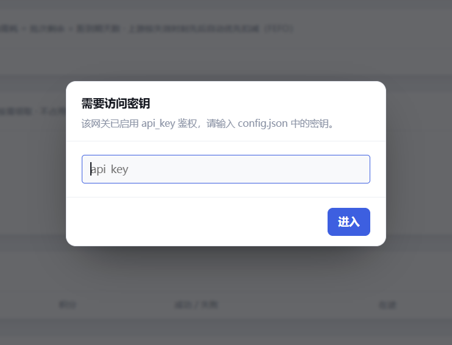
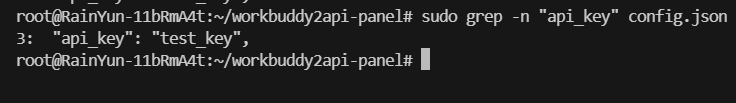
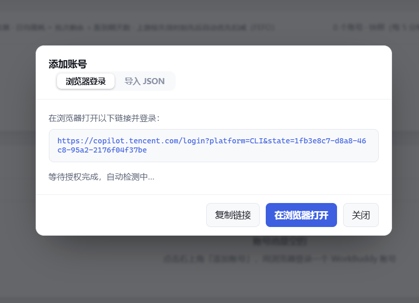
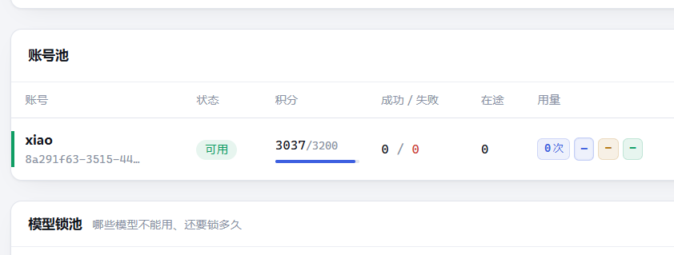
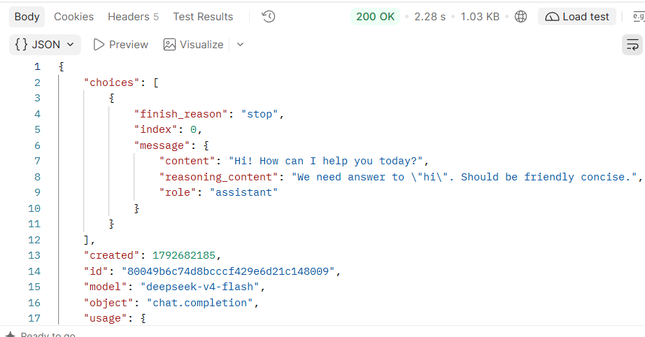

# WorkBuddy 反代 API 搭建教程

> ⚠️ **风险提示**：反代 WorkBuddy，提供管理面板。项目已于 2026-10-21 停止维护（刚好是昨天），有封号风险，目前还可以使用。

项目地址：[workbuddy2api-panel](https://github.com/linguo2625469/workbuddy2api-panel)



## 目录

- [服务器推荐](#服务器推荐)
- [教程](#教程)
  - [1. Ubuntu 系统安装 Docker](#1-ubuntu-系统安装-docker)
  - [2. 部署项目](#2-部署项目)
  - [3. 浏览器登录](#3-浏览器登录)
  - [4. 查看密钥](#4-查看密钥)
  - [5. 添加账号](#5-添加账号)
  - [6. 添加成功](#6-添加成功)
  - [7. 使用](#7-使用)

## 服务器推荐

推荐服务器部署，不要选择国内地区，选择 Linux 版本 Docker 上手快。

腾讯云首尔/雅加达/曼谷地区价格是 199 元一年，2 核 4G 30M 带宽，60GB SSD 盘 1.5T 月流量，推荐首尔地区，系统选 Ubuntu 24。

购买地址：[腾讯云轻量服务器](https://curl.qcloud.com/oyWDLkRJ)



## 教程

### 1. Ubuntu 系统安装 Docker

```bash
sudo apt update
sudo apt install -y ca-certificates curl gnupg
sudo install -m 0755 -d /etc/apt/keyrings
curl -fsSL https://download.docker.com/linux/ubuntu/gpg | sudo gpg --dearmor -o /etc/apt/keyrings/docker.gpg
sudo chmod a+r /etc/apt/keyrings/docker.gpg
echo \
"deb [arch=$(dpkg --print-architecture) signed-by=/etc/apt/keyrings/docker.gpg] https://download.docker.com/linux/ubuntu \
$(. /etc/os-release && echo "$VERSION_CODENAME") stable" | \
sudo tee /etc/apt/sources.list.d/docker.list > /dev/null
sudo apt update
sudo apt install -y docker-ce docker-ce-cli containerd.io docker-buildx-plugin docker-compose-plugin
sudo docker run hello-world
```



### 2. 部署项目

```bash
# 1. 克隆
sudo git clone https://github.com/linguo2625469/workbuddy2api-panel.git
cd workbuddy2api-panel

# 2. 准备配置
sudo cp config.example.json config.json
# 建议编辑 config.json 设置 api_key（或留空由程序自动生成随机密钥）
# sudo nano config.json

# 3. 启动
sudo docker compose up -d --build

# 4. 健康检查
sudo curl -s http://localhost:7863/healthz
# {"healthy":0,"total":0,"service":"workbuddy2api"}
```



### 3. 浏览器登录

记得防火墙放通 7863 端口，才可以访问：

```
http://服务器的IP:7863/panel/
```



### 4. 查看密钥

```bash
sudo grep -n "api_key" config.json
```



### 5. 添加账号



如果提示失败，可以运行以下命令：

```bash
cd ~/workbuddy2api-panel && sudo chown -R 10001:10001 ./auths ./data ./config.json && sudo docker compose restart
```

### 6. 添加成功



### 7. 使用

```bash
curl -sN http://服务器IP:7863/v1/chat/completions \
  -H "Authorization: Bearer your-api-key" \
  -H "Content-Type: application/json" \
  -d '{"model":"deepseek-v4-flash","messages":[{"role":"user","content":"hi"}],"stream":true}'
```



#### Postman 一键导入格式

```bash
curl -X POST "http://你的服务器公网IP:7863/v1/chat/completions" -H "Authorization: Bearer 你的API密钥" -H "Content-Type: application/json" -d "{\"model\":\"deepseek-v4-flash\",\"messages\":[{\"role\":\"user\",\"content\":\"hi\"}],\"stream\":false}"
```